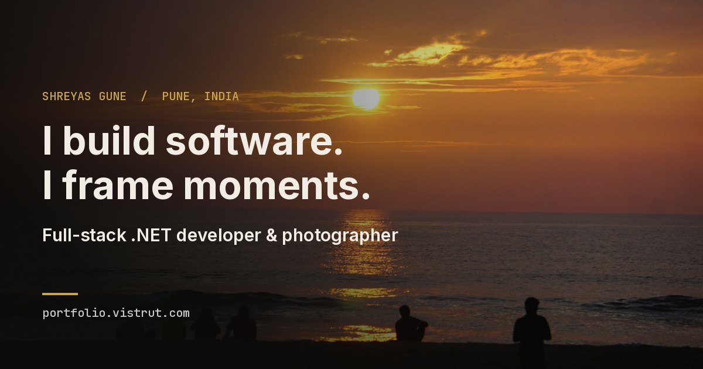

# Shreyas Gune — Portfolio & Photography Platform



**Live site:** [portfolio.vistrut.com](https://portfolio.vistrut.com)

A full-stack personal site that combines a software-development portfolio with a
photography gallery, managed through a private admin CMS. Built with
**ASP.NET Core 9**, **EF Core**, **SQL Server**, **React 19** and **TypeScript**,
and running in production on a Windows/IIS (Plesk) host.

---

## Features

**Public site**
- Photography gallery with albums, masonry layout, "load more" pagination and a full-screen lightbox showing EXIF data (camera, lens, aperture, shutter, ISO)
- Homepage hero photo picked from the CMS; the site's accent colour comes from that photo (palette extracted in the browser when the hero is set)
- Projects section with case-study pages, driven from the database
- About page, downloadable resume, and a contact form

**Admin CMS** (`/admin`, JWT-protected)
- Upload photos, choose the hero photo, and manage albums, categories and tags
- Create, edit and feature projects
- Contact-message inbox with unread counts on the dashboard

**Image pipeline**
- Upload validation for type, size (100 MB) and dimensions (about 50 MP)
- EXIF orientation is applied to the pixels, so portrait photos never appear sideways
- Three resized versions (480 / 1200 / 2400 px) generated with SkiaSharp
- Optional text watermark on the medium and large versions
- Pluggable storage behind `IPhotoStorageService`: **local disk** or **Azure Blob Storage**, switched by one setting ([details](docs/storage/azure-blob-storage.md)). Existing photos keep working after a switch, and the Blob path is tested in CI against Azurite

**Security & performance**
- ASP.NET Core Identity + JWT bearer auth, 12-character passwords, account lockout
- Per-IP rate limiting on login, contact form and upload
- Security headers (CSP, X-Frame-Options, Referrer-Policy, Permissions-Policy), HTTPS redirection, request size limits
- RFC 7807 error responses in production (no leaked stack traces)
- Output caching on public reads, response compression, immutable caching on images
- Database indexes for the main queries; the admin bundle is code-split so public visitors never download it

---

## Architecture

```text
apps/
  api/
    Portfolio.Domain          Entities (Photo, Album, Category, Tag, Project, ContactMessage, SiteSettings)
    Portfolio.Application     DTOs, request models, service interfaces, validation
    Portfolio.Infrastructure  EF Core DbContext + migrations, Identity, image processing, local + Azure Blob storage
    Portfolio.Api             Controllers, middleware, DI and the HTTP pipeline (Program.cs)
    Portfolio.Tests.Unit      xUnit unit tests
  web/                        React 19 + TypeScript + Vite + Tailwind CSS 4 + TanStack Query
tests/
  api-integration/            xUnit + WebApplicationFactory against in-memory SQLite
  web-e2e/                    Playwright end-to-end tests
docs/                         Architecture decisions, deployment runbook, security checklist
```

Dependencies point inward: `Api → Infrastructure → Application → Domain`. Controllers
only talk to Application interfaces, so the database, storage and image processing
can each be swapped without touching the HTTP layer.

In production the React app is built into the API's `wwwroot` and served by the
same ASP.NET Core process (one origin, no CORS needed). The API falls back to
`index.html` for client-side routes.

More detail: [`docs/architecture/overview.md`](docs/architecture/overview.md) ·
[decision log](docs/architecture/decisions.md)

### Known trade-offs
- The admin JWT is kept in `localStorage`. That's acceptable for a single-admin
  site with a strict CSP, but an HttpOnly cookie would be safer against XSS.
- With Azure Blob storage, photos are served from a public container. Fine for a
  public gallery; private photos would need short-lived SAS URLs instead.
- Image versions are generated during the upload request. A background queue
  would make large uploads return faster.
- The SPA is rendered in the browser. Social previews use static meta tags, and
  individual pages are not pre-rendered for search engines.

---

## Running locally

**Prerequisites:** .NET SDK 9, Node.js 22+, SQL Server LocalDB (ships with Visual Studio)

```bash
# 1. Secrets (stored outside the repo via .NET User Secrets)
cd apps/api/Portfolio.Api
dotnet user-secrets set "Jwt:Key" "<random string, 32+ chars>"
dotnet user-secrets set "AdminUser:Username" "<username>"
dotnet user-secrets set "AdminUser:Password" "<password, 12+ chars>"

# 2. Database (dotnet-ef is pinned in Portfolio.Api/.config)
dotnet tool restore
cd ..
dotnet ef database update --project Portfolio.Infrastructure --startup-project Portfolio.Api

# 3. API  ->  http://localhost:5199
dotnet run --project Portfolio.Api

# 4. Frontend  ->  http://localhost:5173
cd ../web
npm install
npm run dev
```

In Development the API seeds sample photos and projects on first run. Photos are
stored on local disk by default; to use Azure Blob Storage locally via the Azurite
emulator, see [docs/storage/azure-blob-storage.md](docs/storage/azure-blob-storage.md). Sign in at
`/admin/login` with the admin credentials you set above.

## Tests

```bash
cd apps/api
dotnet test                                                      # unit tests
dotnet test ../../tests/api-integration/Portfolio.Tests.Integration   # integration tests (in-memory SQLite)

cd ../../tests/web-e2e                                           # E2E (needs both dev servers running)
npm install && npx playwright install chromium && npm test
```

The integration tests check authentication, that admin endpoints reject anonymous requests,
that unpublished content stays hidden from public endpoints, and contact-form
validation. CI (`.github/workflows/ci.yml`) builds and tests the API and the frontend
on every push.

## Deployment

`deploy/build-and-publish.ps1` builds the frontend, copies it into the API's
`wwwroot` (leaving uploaded photos untouched) and publishes the API. Production
settings come from environment variables in `web.config`. A placeholder template
is in `apps/api/Portfolio.Api/web.config.example`; the real file is never committed.
The full runbook is in [`docs/deployment/plesk-deployment-guide.md`](docs/deployment/plesk-deployment-guide.md).

## Roadmap
- [x] Azure Blob Storage provider for photos (behind the existing `IPhotoStorageService`)
- [ ] Generate image versions in a background queue
- [ ] Docker Compose for one-command local setup
- [ ] Structured logging with Serilog + Application Insights
- [ ] Blog / engineering-notes section in the CMS

## How this was built
I planned this project as a sequence of phases (foundation → design system →
data → content → photography → image pipeline → admin → hardening → performance →
testing → deployment) and built it with Claude as an AI pair programmer. I owned the
product decisions and the phase plan, tested each phase, found and reported bugs
(e.g. sideways portrait photos, the gallery showing only one album), and deployed
and run it in production. The day-by-day notes are in [`docs/build-log.md`](docs/build-log.md).

---

**Shreyas Gune** · Full-stack .NET developer · Pune, India ·
[portfolio.vistrut.com](https://portfolio.vistrut.com) · shreyas.gune28@gmail.com
